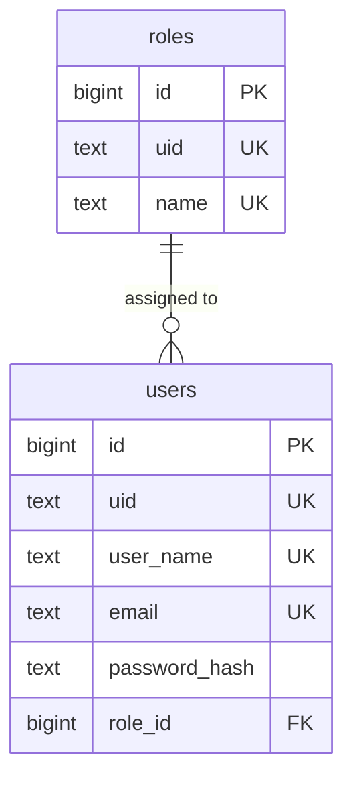

# Database Schema

PostgreSQL, managed with Prisma. `prisma/schema.prisma` implements this design.

## Conventions

- Table and column names are `snake_case`; tables are plural. Prisma models are `PascalCase` singular and map to them with `@@map` / `@map`.
- Every table has two ids: `id bigserial` (auto-increment primary key from Prisma's `autoincrement()`, used by foreign keys and joins) and `uid text default generate_uid()` (a unique 10-character random id from `0-9a-zA-Z`, the only id exposed by the API). `generate_uid()` is a Postgres function created in the `init` migration.
- Timestamps are `timestamp(3)` (no time zone). Prisma always stores them in UTC.
- Fixed value sets are Postgres enums, named in `PascalCase` like their Prisma enums (no `@@map` on enums). Values that grow over time are `text`.
- No soft deletes.

## ER diagram

## Tables

### `roles`

One row per role. Seeded with `USER` and `SUPER_ADMIN` in the `init` migration; code refers to them through the `ROLE` constant (`src/common/constants/roles.ts`).

| Column             | Type           | Null | Notes                                            |
| ------------------ | -------------- | ---- | ------------------------------------------------ |
| `id`               | `bigint`       | no   | PK, auto-increment (`bigserial`)                 |
| `uid`              | `text`         | no   | Unique, default `generate_uid()` (10 characters) |
| `name`             | `text`         | no   | Unique, e.g. `USER`, `SUPER_ADMIN`               |
| `role_permissions` | `jsonb`        | yes  | Not used yet; always empty                       |
| `created_at`       | `timestamp(3)` | no   | Default `now()`                                  |
| `updated_at`       | `timestamp(3)` | no   | Updated by Prisma                                |

### `users`

| Column          | Type           | Null | Notes                                                                |
| --------------- | -------------- | ---- | -------------------------------------------------------------------- |
| `id`            | `bigint`       | no   | PK, auto-increment (`bigserial`)                                     |
| `uid`           | `text`         | no   | Unique, default `generate_uid()` (10 characters)                     |
| `user_name`     | `text`         | no   | Unique, stored lowercase. 3 to 30 characters: `a-z`, `0-9`, `_`, `-` |
| `email`         | `text`         | no   | Unique, stored lowercase                                             |
| `password_hash` | `text`         | no   | Argon2 hash                                                          |
| `role_id`       | `bigint`       | no   | FK → `roles.id`, on delete restrict. New users get the `USER` role   |
| `is_active`     | `boolean`      | no   | Default `true`                                                       |
| `created_at`    | `timestamp(3)` | no   | Default `now()`                                                      |
| `updated_at`    | `timestamp(3)` | no   | Updated by Prisma                                                    |

## Design decisions

- **Two ids per row.** The integer `id` keeps primary keys, foreign keys and indexes small and fast. The random `uid` is what the API exposes, so URLs like `/users/:uid` can't be guessed or counted. The integer `id` never leaves the backend.
- **Roles live in their own table.** Each user has exactly one role through `users.role_id`; many users share a role. New roles are added as rows, without a schema change. A role in use can't be deleted (`on delete restrict`). Permissions are not modelled yet.

## Adding a table

1. Add the model to `prisma/schema.prisma`, following the conventions above (`id`, `uid` with `@default(dbgenerated("generate_uid()"))`, `@@map` to a plural `snake_case` table).
2. Create the migration with `yarn migrate:dev --create-only --name <name>`, review the SQL, then apply it with `yarn migrate:dev`.
3. Document the table here.
